<div align="center">

# ⛺ 나만의 캠핑 퀴즈 게임

**터미널에서 즐기는 캠핑 상식 퀴즈 게임**

퀴즈를 풀고, 직접 문제를 만들고, 최고 점수에 도전해 보세요!


</div>

---

## 📑 목차

1. [프로젝트 개요](#-1-프로젝트-개요)
2. [퀴즈 주제와 선정 이유](#-2-퀴즈-주제와-선정-이유)
3. [실행 방법](#-3-실행-방법)
4. [기능 목록](#-4-기능-목록)
5. [파일 구조](#-5-파일-구조)
6. [데이터 파일 설명 (state.json)](#-6-데이터-파일-설명-statejson)
7. [실행 화면](#-7-실행-화면)
8. [Git 작업 기록](#-8-git-작업-기록)

---

## 📌 1. 프로젝트 개요

Python 기본 문법과 클래스로 만든 **콘솔 퀴즈 게임**입니다.
추가한 퀴즈와 최고 점수는 `state.json`에 저장되어 **프로그램을 껐다 켜도 그대로 남아 있습니다.**

| 항목 | 내용 |
|:---|:---|
| 언어 | Python 3.10 이상 (개발: Python 3.15.2) |
| 라이브러리 | 표준 라이브러리 `json`만 사용 |
| 실행 환경 | 터미널 (Windows PowerShell에서 개발·테스트) |
| 데이터 저장 | `state.json` (UTF-8) |

### 🧱 클래스 구조

```
┌──────────────────────────────┐        ┌───────────────────────────┐
│          QuizGame            │        │           Quiz            │
│  게임 전체를 관리             │ 1 ── N │  퀴즈 문제 1개            │
├──────────────────────────────┤        ├───────────────────────────┤
│ quizzes     퀴즈 목록         │        │ question   문제           │
│ best_score  최고 점수         │        │ choices    선택지 4개     │
├──────────────────────────────┤        │ answer     정답 번호(1~4) │
│ run()            메뉴 반복    │        ├───────────────────────────┤
│ play_quiz()      퀴즈 풀기    │        │ display()       문제 출력 │
│ add_quiz()       퀴즈 추가    │        │ check_answer()  정답 확인 │
│ show_quiz_list() 퀴즈 목록    │        │ to_dict()       저장 변환 │
│ show_score()     점수 확인    │        └───────────────────────────┘
│ load_data()      불러오기     │
│ save_data()      저장하기     │
│ get_number_input() 숫자 입력  │
│ get_text_input()   글자 입력  │
└──────────────────────────────┘
```

---

## 🏕️ 2. 퀴즈 주제와 선정 이유

> **주제: 캠핑**

캠핑은 제가 가장 좋아하는 취미입니다.
캠핑을 다니며 **타프·그라운드시트·펙·코펠**처럼 처음엔 낯설었던 장비 이름과,
**텐트 안 일산화탄소 위험·매너 타임** 같은 꼭 알아야 할 안전 수칙과 매너를 하나씩 배웠습니다.

좋아하는 주제라 즐겁게 문제를 만들 수 있었고,
**캠핑을 처음 시작하는 사람에게 실제로 도움이 되는 퀴즈**를 만들고 싶어 이 주제를 골랐습니다.

---

## 🚀 3. 실행 방법

```bash
# 1. 저장소 복제
git clone https://github.com/jisookkim0809/quiz-game.git

# 2. 폴더 이동
cd quiz-game

# 3. 실행
python main.py
```

> 💡 처음 실행하면 `state.json`이 없으므로 **기본 캠핑 퀴즈 6개**로 시작하고, `state.json`이 자동으로 만들어집니다.

---

## 🎮 4. 기능 목록

### 메뉴

| 번호 | 기능 | 설명 |
|:---:|:---|:---|
| 1 | 📝 퀴즈 풀기 | 퀴즈를 순서대로 출제 → 정답/오답 안내 → 100점 만점 점수 표시 → 최고 점수 갱신 |
| 2 | 📌 퀴즈 추가 | 문제 · 선택지 4개 · 정답 번호를 입력해 새 퀴즈 등록 (자동 저장) |
| 3 | 📋 퀴즈 목록 | 등록된 모든 퀴즈의 문제를 번호와 함께 표시 |
| 4 | 🏆 점수 확인 | 지금까지의 최고 점수 표시 |
| 5 | 👋 종료 | 데이터를 저장하고 종료 |

### 입력 · 예외 처리

| 상황 | 처리 결과 |
|:---|:---|
| 앞뒤 공백 (` 1 `) | 공백 제거 후 정상 처리 |
| 빈 입력 (Enter) | 안내 후 다시 입력 |
| 숫자가 아님 (`abc`) | 안내 후 다시 입력 |
| 범위 밖 (메뉴 `9`, 정답 `0`) | 안내 후 다시 입력 |
| 퀴즈가 0개 | "등록된 퀴즈가 없습니다" 안내 |
| 아직 퀴즈를 안 풀었음 | "아직 퀴즈를 풀지 않았습니다" 안내 |
| `Ctrl + C` / 입력 종료(EOF) | 안내 → **저장** → 안전하게 종료 |
| `state.json` 없음 (첫 실행) | 기본 퀴즈로 시작 + 파일 생성 |
| `state.json` 손상 | 안내 → 기본 퀴즈로 **복구** |

---

## 📁 5. 파일 구조

```
quiz-game/
├── main.py                  # 프로그램 전체 코드 (Quiz, QuizGame)
├── state.json               # 퀴즈·최고 점수 저장 파일 (자동 생성, Git 제외)
├── .gitignore               # Git에 올리지 않을 파일 목록
├── README.md                # 프로젝트 설명서
└── docs/
    └── screenshots/         # 실행 화면 스크린샷
        ├── env.png              개발 환경
        ├── menu.png             메뉴 + 잘못된 입력 처리
        ├── play1~3.png          퀴즈 풀기
        ├── add_quiz1~2.png      퀴즈 추가
        ├── list.png             퀴즈 목록
        ├── score.png            점수 확인
        ├── data_keep.png        재실행 후 데이터 유지
        └── git_log.png          커밋 기록 그래프
```

---

## 💾 6. 데이터 파일 설명 (`state.json`)

| 항목 | 내용 |
|:---|:---|
| 📍 경로 | 프로젝트 루트 `quiz-game/state.json` |
| 🔤 인코딩 | UTF-8 (`ensure_ascii=False`로 한글 그대로 저장) |
| 🎯 역할 | 퀴즈 목록과 최고 점수를 저장해 **재실행해도 데이터 유지** |
| 💾 저장 시점 | 퀴즈 추가 · 최고 점수 갱신 · 정상 종료 · `Ctrl + C` 종료 |
| 📂 불러오기 시점 | 프로그램 시작 시 |
| 🚫 Git 관리 | 실행할 때마다 바뀌는 데이터라 `.gitignore`로 제외 |

### 스키마

| 키 | 자료형 | 설명 |
|:---|:---|:---|
| `quizzes` | `list` | 퀴즈 목록 |
| └ `question` | `str` | 문제 |
| └ `choices` | `list[str]` | 선택지 4개 |
| └ `answer` | `int` | 정답 번호 (1~4) |
| `best_score` | `int` \| `null` | 최고 점수 (100점 만점), 기록이 없으면 `null` |

### 예시

```json
{
    "quizzes": [
        {
            "question": "텐트를 땅에 단단히 고정할 때 박는 말뚝은?",
            "choices": ["코펠", "펙", "랜턴", "릴선"],
            "answer": 2
        }
    ],
    "best_score": 100
}
```

---

## 🖼️ 7. 실행 화면

### 🛠️ 개발 환경
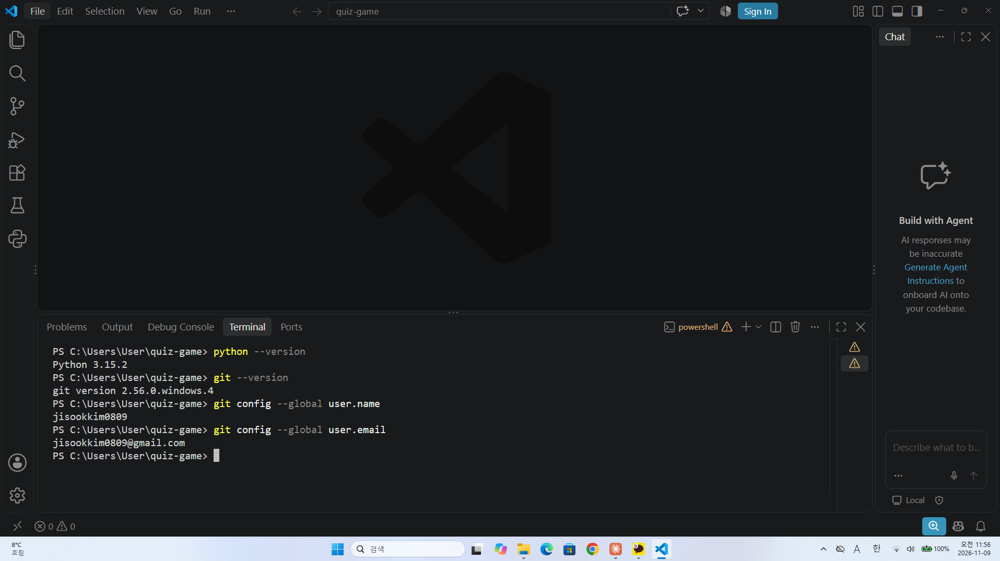

### 📋 메뉴 + 잘못된 입력 처리
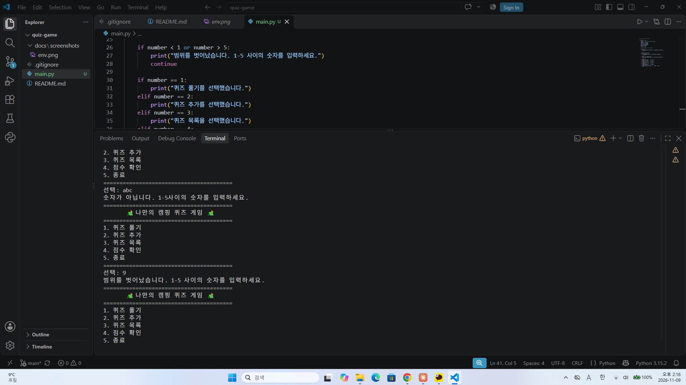

### 📝 퀴즈 풀기
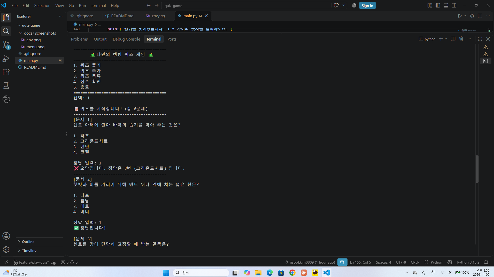
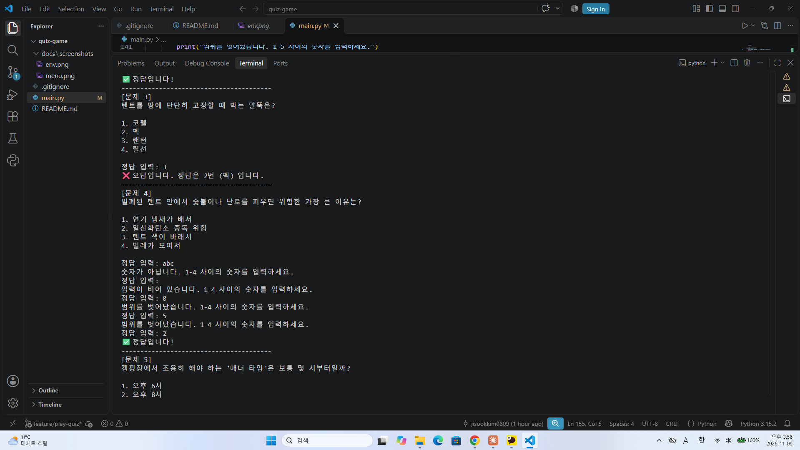
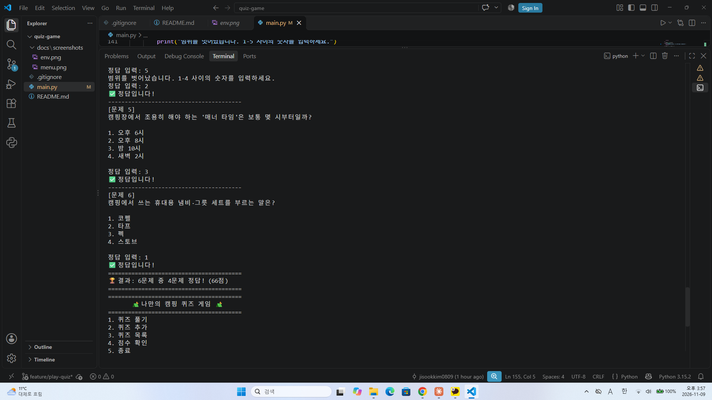

### 📌 퀴즈 추가
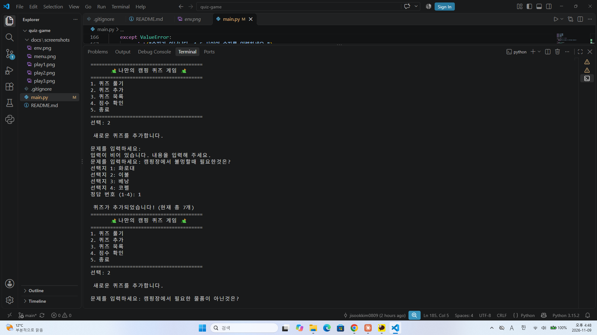
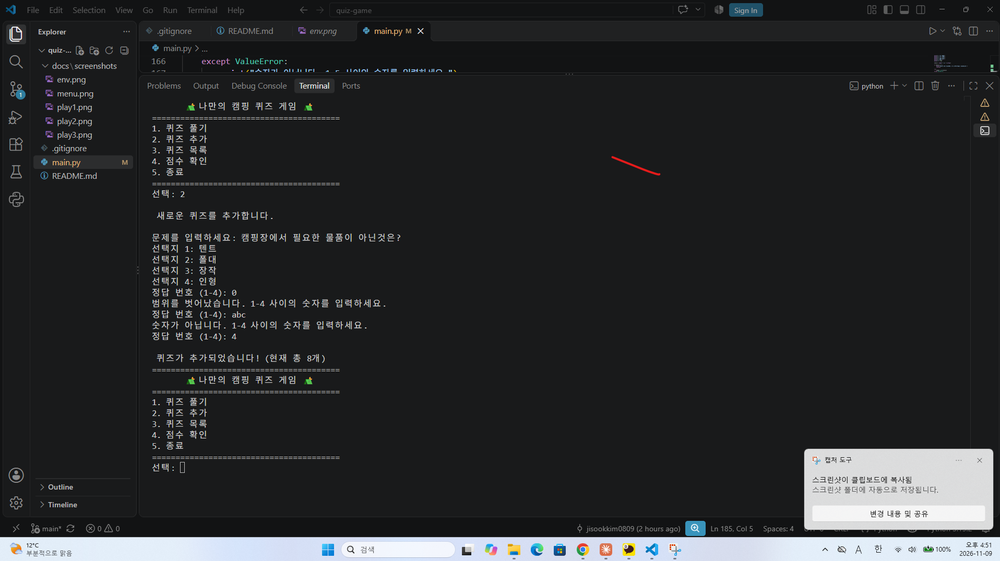

### 📋 퀴즈 목록
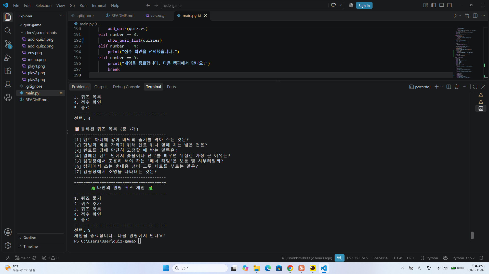

### 🏆 점수 확인
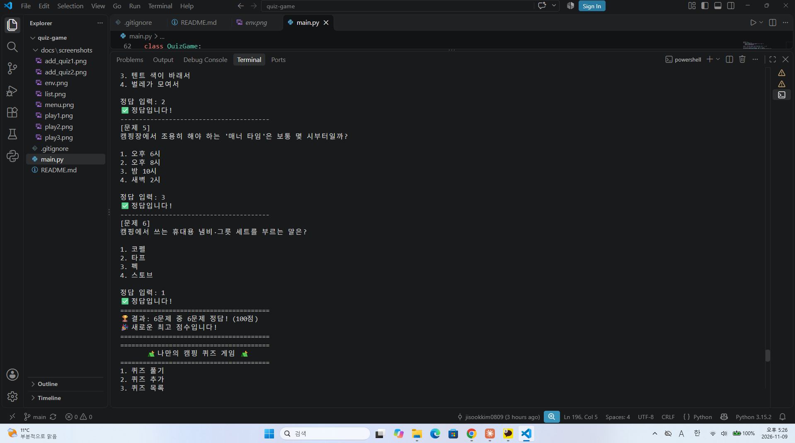

### 💾 재실행 후 데이터 유지
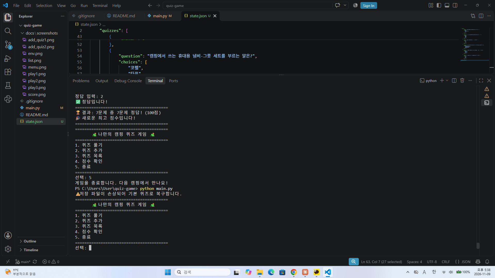

---

## 🌿 8. Git 작업 기록

### 작업 흐름

```
초기 설정 → 메뉴 → Quiz 클래스 → 기본 퀴즈 데이터
   → 🌿 퀴즈 풀기 (feature/play-quiz 브랜치 → main 병합)
   → 퀴즈 추가 → 퀴즈 목록 → 점수 확인
   → QuizGame 리팩터링 → state.json 저장 → 안전 종료 → README
```

### 커밋 메시지 규칙

| 머리말 | 의미 | 예시 |
|:---|:---|:---|
| `Feat:` | 새 기능 | `Feat: 퀴즈 추가 기능 구현` |
| `Fix:` | 오류 수정 | `Fix: Ctrl+C/EOF 입력 시 저장 후 안전 종료 처리` |
| `Refactor:` | 동작은 그대로, 구조 정리 | `Refactor: QuizGame 클래스로 게임 구조 정리` |
| `Docs:` | 문서 · 스크린샷 | `Docs: README 작성` |
| `Chore:` | 설정 | `Chore: 프로젝트 초기 설정` |

### 사용한 Git 명령어

| 명령어 | 사용한 곳 |
|:---|:---|
| `init` · `add` · `commit` · `push` | 저장소 생성, 기능별 커밋 |
| `checkout` · `merge` | `feature/play-quiz` 브랜치 생성 → `main` 병합 |
| `clone` · `pull` | 복제 저장소에서 수정 → 원래 폴더로 받아오기 |

### 커밋 기록 (`git log --oneline --graph`)
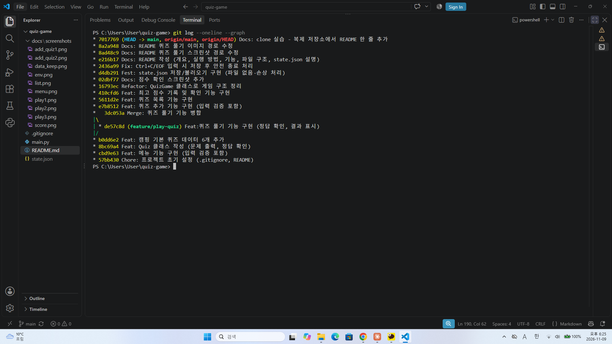

> 🌿 이 줄은 clone/pull 실습을 위해 복제한 저장소(quiz-game-clone)에서 추가했습니다.